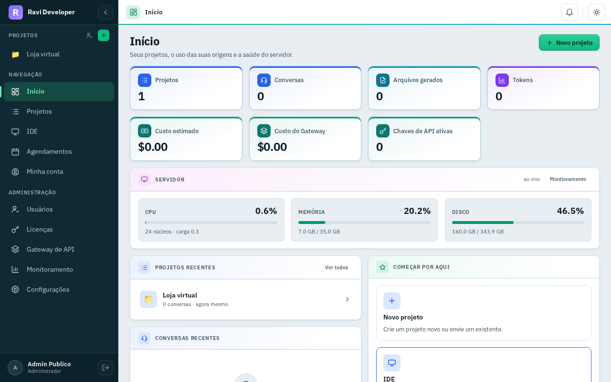
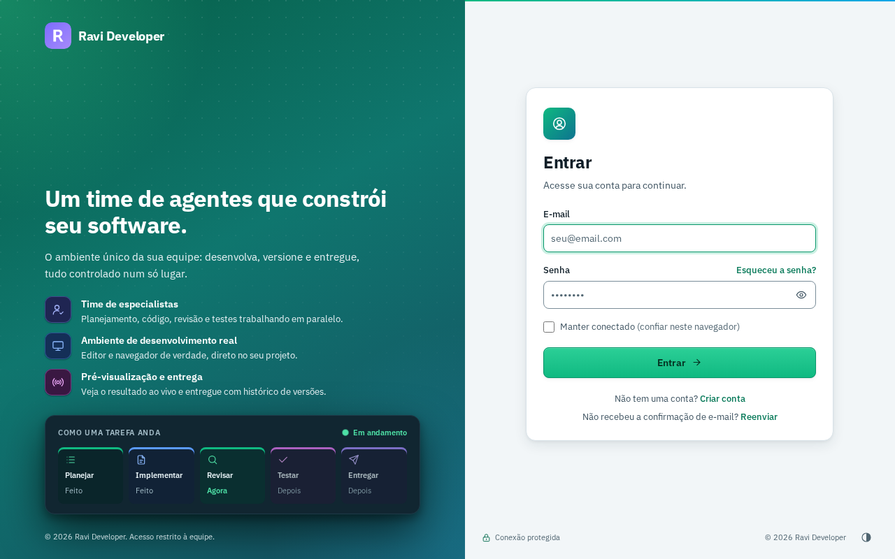
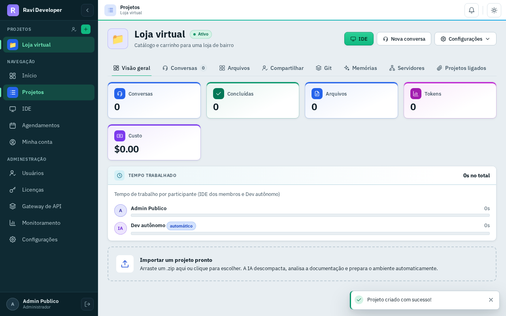
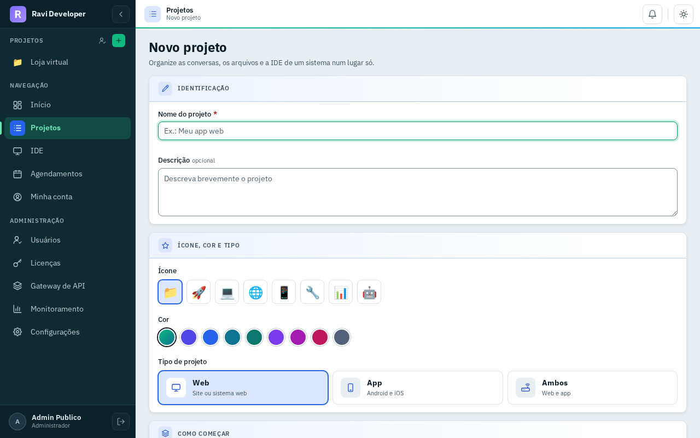
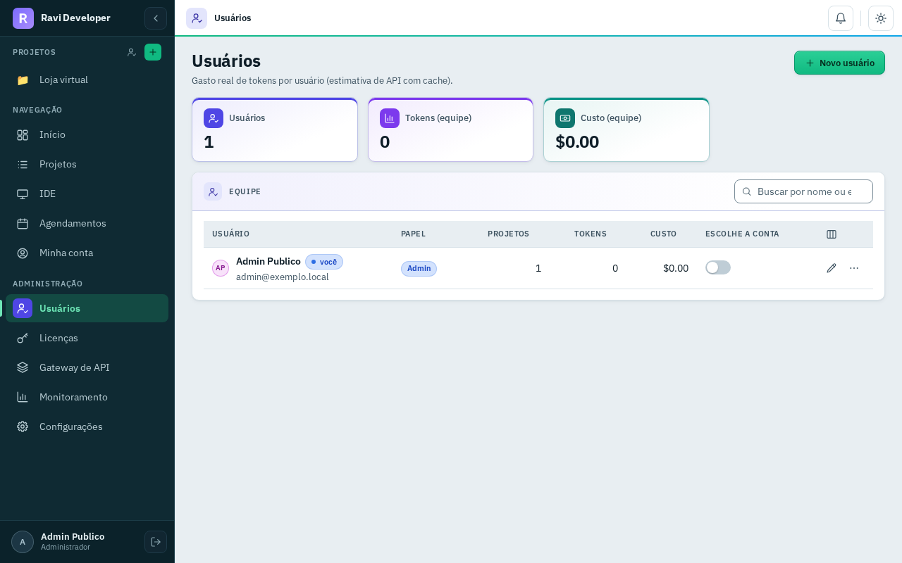
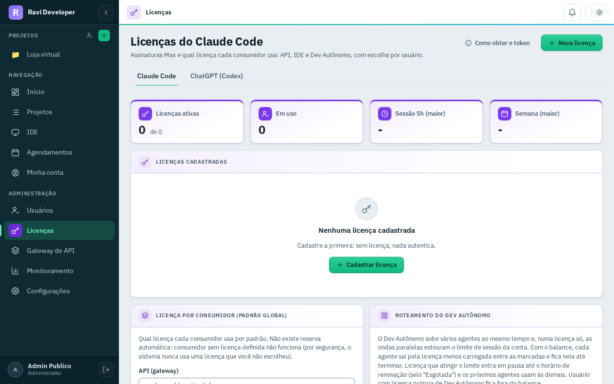
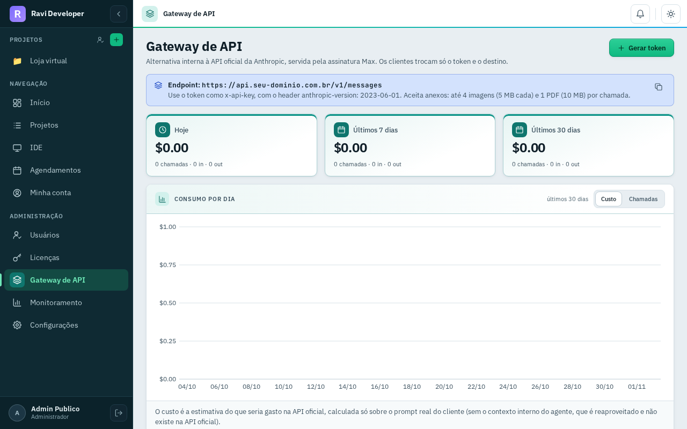
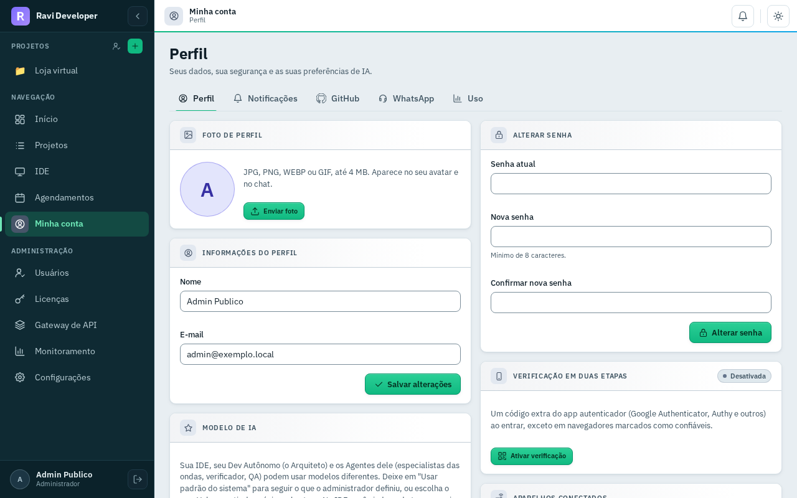

# Ravi Developer

Plataforma web de desenvolvimento com agentes de IA. Cada projeto ganha uma IDE completa no
navegador com o Claude Code, um Dev Autônomo que planeja, constrói, testa e entrega sozinho, um
chat em tempo real e um Gateway de API compatível com a Messages API da Anthropic servido pelas
licenças de assinatura cadastradas no painel.

Código PHP 8.2+ sem framework (MVC próprio), MariaDB, Docker para as IDEs e sandboxes,
WebSocket com Ratchet e dois proxies Python no host que mantêm as credenciais fora dos
containers. Licença MIT.



## O que o sistema faz

| Recurso | O que é | Onde está no código |
|---|---|---|
| IDE por projeto | VS Code (code-server) em container próprio, servido em `/ide/<token>/`, com o `claude` no terminal | `src/Services/IdeService.php`, `docker/Dockerfile.ide`, `public/ide-auth.php` |
| Dev Autônomo (Maestro) | Fase de plano com aprovação e depois ciclos de construção, testes, segurança e entrega por especialistas | `src/Services/MaestroService.php`, `src/Agent/SpecialistRegistry.php`, `bin/queue-worker.php` |
| Chat | Conversa por projeto com streaming via WebSocket | `src/WebSocket/`, `bin/websocket-server.php`, `public/assets/js/paginas/` |
| Gateway de API | `/v1/messages` e `/v1/models` no formato Anthropic, com tokens próprios e consumo por token | `gateway-public/index.php`, `src/Gateway/`, [docs/API-GATEWAY.md](docs/API-GATEWAY.md) |
| Licenças | Credenciais de assinatura Claude e contas ChatGPT cifradas no banco, por escopo (API, IDE, Dev Autônomo), com failover e balanceamento | `src/Services/LicenseService.php`, `src/Services/ChatgptLicenseService.php` |
| Projetos | Git e GitHub (OAuth), membros, memórias, servidores externos por SSH, links, importação de `.zip` ou clone de repositório | `src/Controllers/ProjectController.php`, `src/Services/GitSyncService.php`, [docs/github-oauth.md](docs/github-oauth.md) |
| Preview | Container persistente por projeto em `/p/<token>/`, com MariaDB compartilhado | `src/Services/PreviewService.php` |
| Agendamentos | Comando no sandbox ou prompt para o Claude em horário marcado, com histórico | `src/Services/ScheduleService.php`, `bin/scheduler.php` |
| Usuários e acesso | Login com 2FA (TOTP ou código por e-mail), dispositivos confiáveis, sessões revogáveis, limite de tentativas | `src/Controllers/AuthController.php`, `src/Services/AuthDeviceService.php`, `src/Services/LoginThrottle.php` |
| Monitoramento | Recursos do host, containers e alertas | `src/Services/MonitoringService.php`, `bin/resource-alert-monitor.php` |

## Capturas

Telas de uma instalação nova, no tema claro (o escuro tem a mesma composição).

| Entrada | Início |
|---|---|
|  |  |

| Projeto | Novo projeto |
|---|---|
|  |  |

| Usuários | Licenças |
|---|---|
|  |  |

| Gateway de API | Minha conta |
|---|---|
|  |  |

## Requisitos

- Linux com systemd (o `install.sh` foi escrito para Debian 12)
- PHP 8.2 ou 8.3 com fpm, cli, pdo_mysql, mbstring, xml, curl, zip, gd, intl, bcmath e openssl
- Composer 2
- MariaDB 10.6 ou superior (MySQL não é suportado: as migrations usam sintaxe do MariaDB)
- nginx com o módulo `auth_request` (pacote padrão do Debian já traz)
- Docker Engine (IDEs, sandboxes, previews e backends do Gateway rodam em containers)
- Python 3 (proxies `bin/ide-proxy.py` e `bin/git-proxy.py`, só biblioteca padrão)
- Node 20 entra na imagem da sandbox (`docker/Dockerfile.sandbox`) e é usado pela imagem da IDE
- Supervisor (ou systemd) para manter o WebSocket e o queue-worker de pé

## Instalação

Guia completo em [docs/instalacao.md](docs/instalacao.md). Resumo:

### Automática (Debian 12)

```bash
sudo ./install.sh
```

O script pergunta o domínio do painel, o domínio do Gateway (opcional) e a pasta da instalação,
instala nginx, MariaDB, PHP 8.2, certbot e supervisor, cria o banco, gera o `.env` com a
`APP_KEY`, roda as migrations e o `bin/criar-admin.php`. Ele **não** instala o Docker nem
constrói as imagens, e não configura o queue-worker, o cron nem os proxies: siga os passos 5 a 8
abaixo depois dele.

### Manual

```bash
# 1. Dependências PHP
composer install --no-dev --optimize-autoloader

# 2. Ambiente
cp .env.example .env
# APP_KEY: 32 bytes em base64
sed -i "s|^APP_KEY=.*|APP_KEY=base64:$(php -r 'echo base64_encode(random_bytes(32));')|" .env
# edite APP_URL, DB_*, MAIL_* e o resto conforme a seção de variáveis

# 3. Banco (crie o banco e o usuário antes)
php bin/db-init.php --migrate --seed

# 4. Primeiro administrador
php bin/criar-admin.php            # interativo, ou --nome= --email= --senha=

# 5. nginx e proxies a partir dos modelos
bin/instalar-modelos.sh --dominio seu-dominio.com.br [--dominio-api api.seu-dominio.com.br]
# o script imprime os comandos de ativação (certbot, ln -sf, nginx -t, systemctl enable)

# 6. Imagens Docker
docker build -t ravi-sandbox:latest -f docker/Dockerfile.sandbox docker
docker build -t ravi-sandbox:latest -f docker/Dockerfile.sandbox.claude docker
docker build -t ravi-ide:latest     -f docker/Dockerfile.ide docker

# 7. Serviços: php-fpm, nginx, websocket e queue-worker (supervisor),
#    ravi-ide-proxy e ravi-git-proxy (systemd)

# 8. Cron: scheduler a cada minuto e as limpezas de IDE e preview
```

Depois de entrar no painel como administrador, cadastre ao menos uma licença em
**Administração > Licenças**. A IDE e o Gateway só usam as licenças do banco; o Dev Autônomo,
sem licença no escopo, cai na `CLAUDE_API_KEY` do `.env` (`ClaudeCodeService`).

## Variáveis principais

Todas estão comentadas em `.env.example`.

| Variável | Para que serve |
|---|---|
| `APP_URL`, `APP_KEY`, `APP_ENV`, `APP_DEBUG` | Endereço do painel e chave de criptografia (obrigatória, 32 bytes) |
| `DB_HOST`, `DB_PORT`, `DB_DATABASE`, `DB_USERNAME`, `DB_PASSWORD` | Banco MariaDB |
| `MAIL_*` | SMTP. Com SMTP configurado, o login exige código por e-mail para quem não tem TOTP |
| `CLAUDE_CODE_ENABLED`, `MAESTRO_ENABLED`, `CLAUDE_CODE_MODEL` | Executor das tarefas do chat (Maestro, Claude Code puro ou agente legado) |
| `SANDBOX_IMAGE`, `SANDBOX_MEMORY_LIMIT`, `SANDBOX_CPU_LIMIT` | Container de execução do projeto |
| `IDE_BASE_URL`, `IDE_IMAGE`, `IDE_PORT_MIN`, `IDE_PORT_MAX`, `IDE_NGINX_TRIGGER`, `IDE_IDLE_MINUTES`, `IDE_REAP_DAYS` | IDE no navegador |
| `IDE_PROXY_URL`, `GIT_PROXY_URL` | Endereço dos proxies de credencial vistos de dentro dos containers |
| `PREVIEW_BASE_URL`, `PREVIEW_PORT_MIN`, `PREVIEW_PORT_MAX`, `PREVIEW_NGINX_TRIGGER`, `PREVIEW_DB_*` | Preview dos projetos |
| `GW_PUBLIC_URL`, `GW_MAX_CONCURRENCY`, `GW_LONGAS_MAX`, `GW_SLOT_WAIT`, `GW_PROXY_ENABLED` | Gateway de API |
| `WEBSOCKET_HOST`, `WEBSOCKET_PORT`, `WEBSOCKET_URL` | Servidor do chat |
| `GITHUB_CLIENT_ID`, `GITHUB_CLIENT_SECRET` | Integração com o GitHub |

## Arquitetura em uma página

```
navegador ── nginx ──┬── PHP-FPM (public/index.php) ── src/ (MVC) ── MariaDB
                     ├── /ws  ──> bin/websocket-server.php (Ratchet)
                     ├── /ide/<token>/ ──> code-server do projeto (auth_request em public/ide-auth.php)
                     └── /p/<token>/   ──> container de preview

bin/queue-worker.php   lê job_queue, roda Maestro/Claude Code no container do projeto,
                       grava eventos em agent_events (o WebSocket entrega ao navegador)
bin/scheduler.php      agendamentos e reconciliações, a cada minuto pelo cron
bin/ide-proxy.py       troca o handle do container pelo token real da licença
bin/git-proxy.py       troca o handle do container pelo token do GitHub do dono do projeto
gateway-public/        front isolado do Gateway de API (vhost próprio)
```

Detalhes dos fluxos e das tabelas em [docs/arquitetura.md](docs/arquitetura.md).

## Módulos opcionais

Recursos fora do núcleo vivem em `modulos/<nome>/`, com manifesto `modulo.php`, rotas, views,
migrations e ganchos próprios. Um módulo ausente simplesmente não aparece. Veja
[modulos/README.md](modulos/README.md) e [docs/modulos.md](docs/modulos.md).

## Contribuição

```bash
composer verificar     # lint + phpunit (tests/Unitarios) + phpstan
composer estilo        # phpcs PSR-12
composer start         # servidor local em http://localhost:8080
```

O CI (`.github/workflows/ci.yml`) roda `composer verificar` em PHP 8.2 e 8.3 e a varredura de
segredos (`bin/exportar-publico.sh` seguido de `bin/varrer-segredos.sh`). Antes de abrir um
pull request, rode os dois localmente. Convenções de código e de interface estão em
[CLAUDE.md](CLAUDE.md).

## Licença

MIT. Veja [LICENSE](LICENSE).
